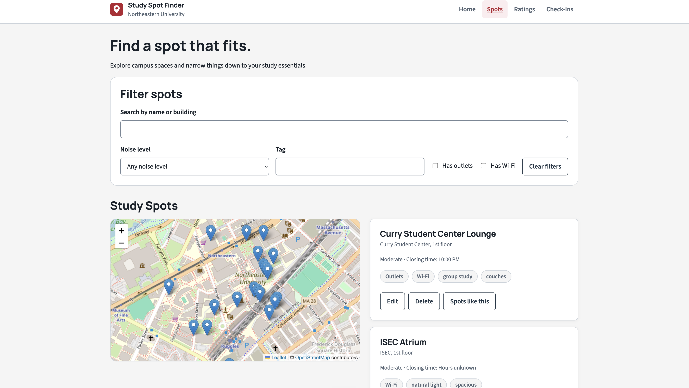
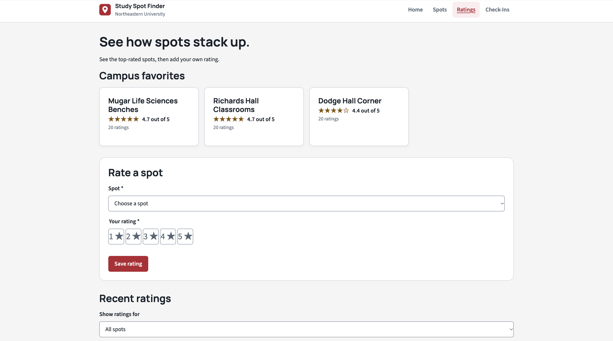
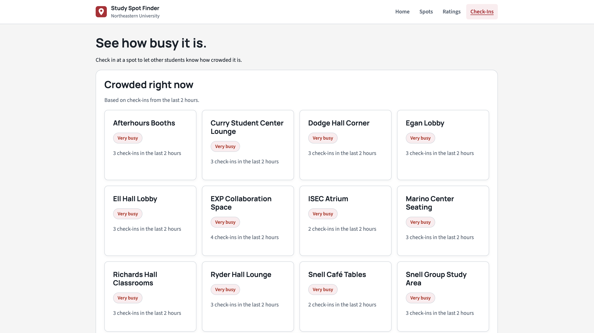
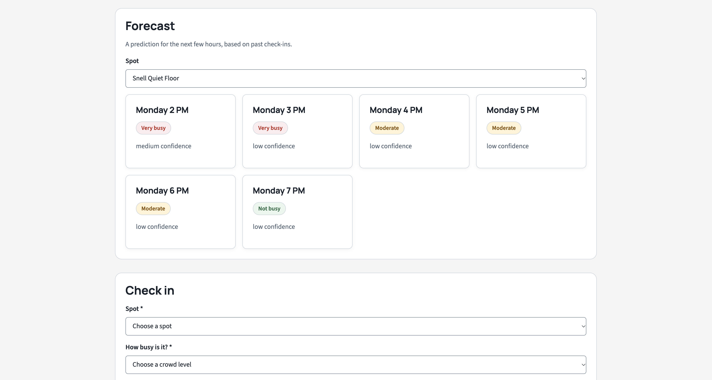

# Study Spot Finder

Find study spots on Northeastern's campus that match how you study.

**Authors:** Eleah Burman and Bryan James
**Class:** [CS5610 Web Development](https://johnguerra.co/classes/webDevelopment_online_fall_2026/), Northeastern University
**Stack:** Node.js, Express, Vanilla ES6, MongoDB (Node driver), Leaflet with OpenStreetMap
**Design:** [Figma file](https://www.figma.com/design/gAZKaGijIlob4iAr49KcYV/Untitled)
**Design document:** [Design Document (PDF)](docs/design-document.pdf) · [Markdown version](docs/design-document.md)
**Deployed site:** https://study-spot-finder.onrender.com
**Demo video:** _coming soon_

---

## Screenshots

### Home

### Spots

### Ratings

### Check-Ins

### Crowd forecast

## Project Objective

A web app that helps students find study spots on campus that match their preferences. Users can add study spots with details like noise level, outlets, Wi-Fi, closing time, and tags, and view them on a map limited to Northeastern's campus. Students can rate spots from 1 to 5 stars and check in to report how crowded a spot is. The app also includes a k-nearest neighbors recommender that suggests similar spots, and a crowd forecast that predicts how busy a spot will be at a given day and time. Both algorithms are written from scratch in plain JavaScript.

---

## Schedule

**Due: Tuesday, October 20 at 2:59 PM.** Code freezes 24 hours before class, so all code must be merged by **Monday, October 19 at 2:59 PM**.

| When                                | Eleah                                            | Bryan                                                          |
| ----------------------------------- | ------------------------------------------------ | -------------------------------------------------------------- |
| **Saturday, Oct 17**                | Spots seed script, first deployment, Leaflet map | `checkins` CRUD routes and tests, Ratings page, Check-Ins page |
| **Sunday, Oct 18**                  | KNN recommender, styling pass                    | Ratings and check-ins seed scripts, crowd forecast             |
| **Monday, Oct 19 (before 2:59 PM)** | Screenshot, README, final fixes                  | Final fixes                                                    |
| **Monday, Oct 19 (after freeze)**   | Demo video and submission form (both)            | Demo video and submission form (both)                          |

If something is running late, say so in Slack right away so the other person can plan around it.

---

## Golden Rule

**Only directly edit files you own.** If a change is needed in someone else's file, message them first and agree on who makes it.

Shared files (`server.js`, `db.js`, `package.json`, `public/index.html`, `public/css/shared.css`, `public/css/nav.css`) stay stable after setup unless you both agree on a change.

---

## Folder Structure

    study-spot-finder/
    ├── server.js              # Eleah (shared)
    ├── db.js                  # Eleah (shared)
    ├── package.json           # Shared
    ├── eslint.config.js       # Shared
    ├── .prettierrc            # Shared
    ├── .gitignore             # Bryan
    ├── LICENSE                # MIT
    ├── README.md              # Both (see rules below)
    ├── docs/
    │   ├── design-document.md # Both (project description, personas, stories, mockups)
    │   ├── design-document.pdf # Both (PDF export of the design document)
    │   └── images/
    │       └── mockups.png
    ├── routes/
    │   ├── spots.js           # Eleah
    │   ├── ratings.js         # Bryan
    │   └── checkins.js        # Bryan
    ├── ml/
    │   ├── knn.js             # Eleah
    │   ├── crowd.js           # Bryan (crowd scores and campus day and hour)
    │   └── forecast.js        # Bryan
    ├── seed/
    │   ├── spots.js           # Eleah (runs the seed)
    │   ├── spotsData.js       # Eleah (the 20 seed spots)
    │   ├── ratings.js         # Bryan (400 sample ratings)
    │   └── checkins.js        # Bryan (600 sample check-ins)
    ├── tests/
    │   ├── db.test.js         # Eleah
    │   ├── spots.test.js      # Eleah
    │   ├── spotUtils.test.js  # Eleah
    │   ├── spotsData.test.js  # Eleah
    │   ├── knn.test.js        # Eleah
    │   ├── confirmDialog.test.js # Eleah
    │   ├── ratings.test.js    # Bryan
    │   ├── ratingsUtils.test.js # Bryan
    │   ├── checkins.test.js   # Bryan
    │   ├── checkinsUtils.test.js # Bryan
    │   ├── crowd.test.js      # Bryan
    │   └── forecast.test.js   # Bryan
    └── public/
        ├── index.html         # Eleah (shared, nav links to all pages)
        ├── favicon.ico        # Eleah (map pin icon, shared by every page)
        ├── spots.html         # Eleah
        ├── ratings.html       # Bryan
        ├── checkins.html      # Bryan
        ├── css/
        │   ├── shared.css     # Eleah (variables, base, buttons, forms, cards)
        │   ├── nav.css        # Eleah (nav on every page)
        │   ├── home.css       # Eleah (home page)
        │   ├── spots.css      # Eleah
        │   ├── ratings.css    # Eleah
        │   └── checkins.css   # Eleah
        ├── images/
        │   ├── homepage.png    # Eleah (home page photo)
        │   └── logo.svg        # Eleah (nav logo)
        └── js/
            ├── spots.js       # Eleah
            ├── home.js        # Eleah (home page featured spots)
            ├── spotUtils.js   # Eleah (formatting, tag, filter, and match reason helpers)
            ├── map.js         # Eleah
            ├── confirmDialog.js # Eleah (shared delete dialog, used by every page)
            ├── ratings.js     # Bryan
            ├── ratingsUtils.js # Bryan (formatting and filter helpers)
            ├── checkins.js    # Bryan
            └── checkinsUtils.js # Bryan (formatting and validation helpers)

---

## Who Owns What

| Area        | Eleah                                                               | Bryan                                                            |
| ----------- | ------------------------------------------------------------------- | ---------------------------------------------------------------- |
| Collections | `spots`                                                             | `ratings`, `checkins`                                            |
| Routes      | `/api/spots`                                                        | `/api/ratings`, `/api/checkins`                                  |
| Pages       | `index.html`, `spots.html`                                          | `ratings.html`, `checkins.html`                                  |
| Algorithm   | KNN recommender (`ml/knn.js`)                                       | Crowd forecast (`ml/forecast.js`)                                |
| Extras      | Leaflet map, filters                                                | Average rating, "crowded now"                                    |
| Styles      | All CSS files                                                       | Uses classes from the CSS files                                  |
| Setup       | `server.js`, `db.js`, route mounting, nav, license, Prettier/ESLint | Dependencies, `.gitignore`, `ratings.js` and `checkins.js` stubs |

Ratings and check-ins store the **spot name as text**, so Bryan never depends on Eleah's code.

---

## Why This Avoids Collisions

- `server.js` mounts all three route files. Bryan never edits it.
- `index.html` nav links to all pages. Bryan never edits it.
- Every route file started as a stub that exports an empty router, so the server ran from day one.
- All CSS is written by Eleah, split by module. Bryan uses the classes in his pages. If he needs a new style, he asks Eleah.
- Everyone uses `getDB()` from `db.js` to reach the database. Nobody opens a second connection.

---

## Styling Guide

CSS is split into modules. Every page links `shared.css` and `nav.css`, plus its own file:

| Page            | CSS files                               |
| --------------- | --------------------------------------- |
| `index.html`    | `shared.css`, `nav.css`                 |
| `spots.html`    | `shared.css`, `nav.css`, `spots.css`    |
| `ratings.html`  | `shared.css`, `nav.css`, `ratings.css`  |
| `checkins.html` | `shared.css`, `nav.css`, `checkins.css` |

To start a new page, copy the `<head>` and `<nav>` from `index.html`, add the page's own CSS link, and move `aria-current="page"` to that page's nav link.

Common classes:

| Class                                                                | File     | Use                                                  |
| -------------------------------------------------------------------- | -------- | ---------------------------------------------------- |
| `container`                                                          | shared   | Centers content and sets max width (use on `<main>`) |
| `card`, `card__header`, `card__title`, `card__meta`, `card__actions` | shared   | Cards and info boxes                                 |
| `panel`                                                              | shared   | Larger sections like forms and charts                |
| `btn btn--primary`, `btn btn--secondary`                             | shared   | Buttons                                              |
| `form`, `field`, `field__label`, `input`, `select`, `textarea`       | shared   | Forms                                                |
| `field__hint`, `field__error`                                        | shared   | Help text and error messages under inputs            |
| `field--checkbox`                                                    | shared   | A checkbox next to its label                         |
| `tag`                                                                | shared   | Static tags                                          |
| `spot-grid`, `spots-layout`, `map`, `chip`, `filters`, `card__tags`  | spots    | Spots page layout, map, and filter chips             |
| `form__actions`                                                      | spots    | A row of form buttons (like Save and Cancel)         |
| `rating`, `star-rating`                                              | ratings  | Average rating display and 1 to 5 star input         |
| `status--success`, `status--warning`                                 | checkins | Crowd badges like "Not busy" or "Moderate"           |

Colors, fonts, and spacing are CSS variables in `:root` in `shared.css` (for example `var(--color-primary)` or `var(--space-4)`). Use those instead of hex codes. Don't use `!important`.

---

## Git Workflow

1. Always `git pull origin main` before starting.
2. Work on your own branch: `eleah/feature-name` or `bryan/feature-name`.
3. Before committing, run `npm run format`, `npm run lint`, and `npm test`. Fix any errors.
4. Open a pull request into `main`. The other person gives it a quick look.
5. Never push straight to `main`.
6. **New dependency?** Discuss it with the other person first. Include the `package.json` and `package-lock.json` changes in the same PR as the code that needs them.
7. **README edits:** Only check off your own boxes below. Bigger README changes go in their own PR.
8. Stage files by name (`git add file.js`), not `git add .`, so nothing unexpected gets committed.

---

## Scripts

| Command                | What it does                                |
| ---------------------- | ------------------------------------------- |
| `npm run dev`          | Starts the server and restarts on save      |
| `npm start`            | Starts the server (used for deployment)     |
| `npm run lint`         | Checks for code errors with ESLint          |
| `npm run format`       | Formats all files with Prettier             |
| `npm run format:check` | Checks formatting without changing files    |
| `npm test`             | Runs tests with Node's built-in test runner |

ES modules only: use `import` and `export`, never `require()`.

---

## Environment Variables

Each person makes their own `.env` file in the project root. It's gitignored and never pushed.

    MONGO_URI=your-connection-string-here
    PORT=3000

- Get the connection string from Bryan, then swap in your own database username and password.
- Use your own database user. Never share passwords in the repo or chat.
- Bryan manages database users and Network Access in Atlas.
- The map uses Leaflet with OpenStreetMap, which needs no API key.

**Database name:** `studySpotFinder`

---

## Data Model

Ratings and check-ins reference spots by **name**, so spot names must be unique. **All three collections need full CRUD** (create, read, update, delete). Full field details are in the [design document](docs/design-document.md).

| Collection | Fields                                                                                                                            |
| ---------- | --------------------------------------------------------------------------------------------------------------------------------- |
| `spots`    | `name` (required, unique), `building` (required), `noiseLevel` (required), `outlets`, `wifi`, `closingTime`, `tags`, `lat`, `lng` |
| `ratings`  | `spotName`, `stars` (1 to 5), `createdAt`                                                                                         |
| `checkins` | `spotName`, `crowdLevel`, `day`, `hour`, `note` (optional), `createdAt`                                                           |

**Decisions:**

- `noiseLevel` is Quiet, Moderate, or Loud.
- `crowdLevel` is Not busy, Moderate, or Very busy.
- Spots have a required `building` field.
- Ratings are stars only, with no written review field.
- If a spot is renamed or deleted, its ratings and check-ins are left as they are.
- Anyone can edit or delete a rating or check-in (no user accounts).
- Check-in `day` and `hour` are set by the server in campus time (America/New_York), so nobody can check in for another time.

---

## API Endpoints

| Method           | Endpoint                    | Owner | Notes                                                            |
| ---------------- | --------------------------- | ----- | ---------------------------------------------------------------- |
| GET, POST        | `/api/spots`                | Eleah |                                                                  |
| GET, PUT, DELETE | `/api/spots/:id`            | Eleah |                                                                  |
| GET              | `/api/spots/:id/similar`    | Eleah | The 3 most similar spots (KNN), each with a distance and reasons |
| GET, POST        | `/api/ratings`              | Bryan | GET accepts an optional `?spotName=`                             |
| GET              | `/api/ratings/averages`     | Bryan | Average stars and count for each spot                            |
| GET, PUT, DELETE | `/api/ratings/:id`          | Bryan |                                                                  |
| GET, POST        | `/api/checkins`             | Bryan | GET accepts optional `?spotName=` and `?limit=` (1 to 100)       |
| GET              | `/api/checkins/crowded-now` | Bryan | Average crowd level for each spot from the last 2 hours          |
| GET              | `/api/checkins/forecast`    | Bryan | Needs `?spotName=`, optional `?hours=` (1 to 24, default 6)      |
| GET, PUT, DELETE | `/api/checkins/:id`         | Bryan |                                                                  |

Errors are returned as `{ "error": "message" }` with status `400` (bad input), `404` (not found), `409` (duplicate), or `500` (server error).

---

## Algorithms

- **KNN recommender (Eleah):** Finds the spots most similar to a chosen spot based on noise, outlets, Wi-Fi, and tags, and explains why each one matched. Plain JavaScript, no libraries.
- **Crowded now (Bryan):** Average crowd level from check-ins in the last 2 hours.
- **Crowd forecast (Bryan):** For a chosen spot, predicts the crowd level for each of the next few hours using a weighted average of past check-ins. Check-ins from the same day and nearby hours count more, and recent check-ins count more than old ones. It also gives a confidence that grows with the amount of matching data. Plain JavaScript, no libraries.

---

## Rubric Checklist

- [x] Design document as a separate file, linked from this README
- [x] Node + Express backend
- [x] ES modules only (no `require()`)
- [x] MIT license
- [x] ESLint config, zero lint errors
- [x] Prettier formatting
- [x] CSS organized by module
- [x] Client-side rendering with vanilla JS (no template engines)
- [x] At least 1 form
- [x] At least 2 MongoDB collections with full CRUD (spots, ratings, and check-ins)
- [x] 1,000+ database records (via seed scripts)
- [x] Publicly deployed
- [ ] Narrated public demo video
- [ ] Code review
- [x] README: authors, class link, objective, screenshot, build instructions
- [x] Code frozen 24 hours before class
- [ ] Final submission form with thumbnail

---

## Roadmap

Must-haves come first. The map and algorithms come after the core app is deployed and working.

### Phase 0: Setup

- [x] **Bryan:** `npm init`, install dependencies (`express`, `mongodb`, `dotenv`), `.gitignore`, push to `main`
- [x] **Bryan:** `.DS_Store` cleanup
- [x] **Bryan:** Stubs in `routes/ratings.js` and `routes/checkins.js`
- [x] **Eleah:** `db.js` with `connectDB()`, `getDB()`, and `closeDB()`
- [x] **Eleah:** `server.js` with Express, JSON, static `public` folder, connects before listening
- [x] **Eleah:** `package.json` set to ES modules, scripts added
- [x] **Eleah:** All three routers mounted in `server.js`
- [x] **Eleah:** `public/index.html` shell with styled nav
- [x] **Eleah:** CSS split into modules (`shared`, `nav`, `spots`, `ratings`, `checkins`)
- [x] **Eleah:** MIT license, Prettier, ESLint
- [x] **Eleah:** `tests/db.test.js`
- [x] **Both:** Pull, run `npm run dev`, confirm "Connected" and "Server running on port 3000"

### Phase 1: Backend (full CRUD)

- [x] **Both:** Agree on the data model and the API response format
- [x] **Eleah:** `spots` CRUD routes in `routes/spots.js`
- [x] **Eleah:** Route tests in `tests/spots.test.js`
- [x] **Bryan:** `ratings` CRUD routes and average rating in `routes/ratings.js`
- [x] **Bryan:** Route tests in `tests/ratings.test.js`
- [x] **Bryan:** `checkins` CRUD routes and "crowded now" (last 2 hours) in `routes/checkins.js`, plus tests

### Phase 2: Frontend (client-side rendering)

- [x] **Eleah:** `spots.html` and `js/spots.js`: fetch from `/api/spots`, render cards, add/edit/delete form
- [x] **Eleah:** `js/spotUtils.js` helpers with tests in `tests/spotUtils.test.js`
- [x] **Eleah:** Filters on the Spots page (noise, outlets, Wi-Fi, tags)
- [x] **Bryan:** `ratings.html` and `js/ratings.js`: star rating UI, average rating, spot dropdown
- [x] **Bryan:** `checkins.html` and `js/checkins.js`: check-in form, "crowded now"

### Phase 3: Data and Deployment

- [x] **Eleah:** Seed script for spots in `seed/`
- [x] **Bryan:** Seed scripts for ratings and check-ins in `seed/` (enough for 1,000+ records total)
- [x] **Eleah:** Deploy and confirm the live site connects to MongoDB

### Phase 4: Map and Algorithms

- [x] **Eleah:** Leaflet map limited to campus bounds, with click-to-set location
- [x] **Eleah:** KNN recommender in `ml/knn.js` with explanations, plus tests
- [x] **Bryan:** Weighted forecast in `ml/forecast.js`, plus tests

### Phase 5: Submission

- [x] **Eleah:** Final styling pass: map next to the spot list, compact filters, and spacing
- [x] **Eleah:** Replace `confirm()` with a shared, styled delete dialog (`js/confirmDialog.js`)
- [x] **Eleah:** Make the "No check-ins in the last 2 hours" message span the full width (`.checkin-grid > p`)
- [x] **Eleah:** Add a hover style to the star rating
- [x] **Eleah:** Add a favicon
- [x] **Bryan:** Switch Ratings and Check-Ins to the shared delete dialog
- [ ] **Both:** Screenshot, deployed URL, and video link in README
- [ ] **Both:** Narrated demo video
- [x] **Both:** Freeze code 24 hours before class
- [ ] **Both:** Submit the final form with thumbnail

---

## What's Next

**Bryan (today, Saturday):**

1. `checkins` CRUD routes and tests on a `bryan/checkins` branch
2. Ratings page on a `bryan/ratings-page` branch. The ratings form should use a dropdown of existing spot names from `/api/spots`.
3. Check-Ins page on a `bryan/checkins-page` branch

`public/js/spots.js` and `public/js/spotUtils.js` are working examples of fetching, rendering, and testable helpers.

**Eleah (today, Saturday):**

1. Spots seed script
2. First deployment
3. Leaflet map on the Spots page

---

## Running Locally

**You need:** Node.js, your own `.env` (see above), and your IP added in Atlas Network Access.

    npm install
    npm run dev

Then open http://localhost:3000

You should see "Connected" and "Server running on port 3000." If the connection fails, check your `MONGO_URI` and Atlas Network Access.

Use `localhost:3000`, not VS Code's Live Server. Live Server can show the HTML, but it doesn't run the `/api` routes.

To run tests:

    npm test

To fill the database with sample data:

    npm run seed:spots
    npm run seed:ratings
    npm run seed:checkins

Seed scripts are safe to run more than once. The spots script updates existing records, and the ratings and check-ins scripts replace their own sample records (marked `seeded`). "Crowded now" only counts check-ins from the last 2 hours, so run `npm run seed:checkins` again right before a demo.

---

## License

[MIT](LICENSE)
