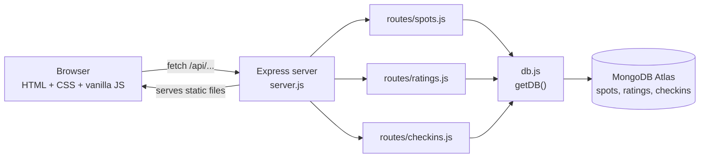

# Study Spot Finder: Design Document

**Authors:** Eleah Burman and Bryan James
**Class:** [CS5610 Web Development](CLASS_LINK_HERE), Northeastern University
**Project repo:** [study-spot-finder](https://github.com/BryanSJamesDev/study-spot-finder)

---

## 1. Project Description

### The problem

Finding a good place to study on campus usually means walking from building to building until you find an open seat. Even then, the spot might be too loud, have no outlets, or close an hour after you sit down. Students end up relying on word of mouth or luck, and the information they need (how quiet is it, can I plug in my laptop, is it packed right now) isn't written down anywhere.

### Our solution

Study Spot Finder is a web app where Northeastern students share and find study spots on campus. Students can:

- **Add and browse study spots** with details like noise level, outlets, Wi-Fi, closing time, and tags such as "group study" or "natural light."
- **See spots on a campus map** and filter them to match how they like to study.
- **Rate spots** from 1 to 5 stars and see each spot's average rating.
- **Check in** to report how crowded a spot is, and see how busy it is right now based on the last 2 hours of check-ins.
- **Get recommendations** for similar spots, using a k-nearest neighbors algorithm that explains why each spot matched.
- **See a crowd forecast** that predicts how busy a spot will be at each hour of a chosen day, based on past check-ins.

### Who it's for

Northeastern students who study on campus, especially those who have specific needs, like a quiet room, an outlet, or a table for a group, and don't want to waste time searching.

### Why it's useful

The app turns scattered, word-of-mouth knowledge into shared, searchable information. Because students add the spots, ratings, and check-ins themselves, the information stays current, and the more people use it, the better the recommendations and forecasts get.

---

## 2. User Personas

### Maya, the quiet-study grad student

- **Who:** 26, first-year Master's student in Data Science. Commutes from Brooklyn three days a week.
- **Habits:** Comes to campus with a long block of time between classes. Needs a silent space and an outlet, since her laptop battery dies by midday.
- **Frustrations:** Wastes 20 minutes walking between buildings looking for a quiet spot with an open outlet. The library's silent floor is often full by the time she arrives.
- **What she needs from the app:** Filter by noise level and outlets, and see how crowded a spot is before she walks over.

### Jordan, the group-project organizer

- **Who:** 20, third-year undergrad in Business. Always the one coordinating study sessions for group projects.
- **Habits:** Needs a table for 4 to 6 people where talking is okay. Plans sessions a day or two ahead.
- **Frustrations:** Group study rooms are booked up, and open tables are hard to find at peak times. He doesn't know when spots are least busy.
- **What he needs from the app:** Tags like "group study," the crowd forecast to pick a time when tables will be open, and ratings from other students on which spots actually work for groups.

### Priya, the new transfer student

- **Who:** 19, second-year undergrad who just transferred to Northeastern. Doesn't know the campus yet.
- **Habits:** Studies between classes in whatever building she's already in. Likes natural light and a calm, but not silent, atmosphere.
- **Frustrations:** Only knows the main library. Doesn't know which other buildings have good spaces or where they are.
- **What she needs from the app:** The campus map to discover spots near her, and "spots like this" recommendations to find new places similar to one she already likes.
  
---

## 3. User Stories

### Story 1: Adding a study spot (Eleah)

> As a student, I want to add, edit, and delete a study spot with its noise level, outlets, Wi-Fi, closing time, tags, and location, so that other students know what it's like.

Priya finally finds a spot she loves: a bright, calm lounge on the second floor of a building near her classes. It has big windows and a few outlets along the wall, and nobody else seems to know about it. She opens Study Spot Finder, goes to the Spots page, and fills out the "Add a study spot" form. She enters the name, sets the noise level to moderate, marks outlets and Wi-Fi as available, adds the closing time, and tags it "natural light." The spot appears on the map and in the list right away. A week later she notices the lounge now closes earlier, so she clicks "Edit spot" and updates the closing time.

### Story 2: Finding a spot on the map, and similar ones (Eleah)

> As a student, I want to see spots on a map, filter them by noise, outlets, and tags, and see a "spots like this" list on any spot, so that I can quickly find a place that fits how I study.

Maya has three hours before her evening class and needs to get work done. She opens the Spots page and filters by "Quiet" noise level and "Outlets: Available." The map narrows down to two pins near her. She clicks the library, but she's been there before and it's usually packed by noon. She scrolls to "Spots like this," which shows a quiet study room in another building with outlets and Wi-Fi. The app explains the match: same noise level, outlets, and Wi-Fi. She heads there instead.

### Story 3: Rating a study spot (Bryan)

> As a student, I want to give a spot a 1 to 5 star rating, edit or delete my rating, and see each spot's average rating, so that I know which places are worth going to.

Jordan's group met at the student center for their project. The tables were big enough, but it got loud around lunch. After the session, he goes to the Ratings page, picks the student center, and gives it 3 stars. The spot's average rating updates. The next time he plans a session, he checks the Ratings page first and picks a spot with a 4.5 average that other students say works well for groups.

### Story 4: Checking in and seeing the crowd forecast (Bryan)

> As a student, I want to submit, edit, and delete a check-in that reports how crowded a spot is, see how crowded it is right now, and see how busy it's predicted to be at each hour, so that I can avoid crowded times.

Jordan needs to book a group session for Thursday. On the Check-Ins page, he picks a spot and Thursday, and the hourly forecast shows it's busiest at noon and quieter at 9 a.m. He schedules the session for the morning. On Thursday, when the group arrives, he submits a quick check-in: "Not busy," with a note that the big tables by the window are open. Maya, checking the app across campus, sees that it's not crowded right now and decides to head over too.

---

## 4. Design Mockups

Mockups were designed in Figma for both desktop and mobile. [View the full Figma file](https://www.figma.com/design/gAZKaGijIlob4iAr49KcYV/Untitled).


### Style guide

Defines the color tokens, typography, spacing scale, and shared components (nav, cards, buttons, form inputs, tags, and star rating) used on every page. These map directly to the CSS variables in `public/css/shared.css`.

### Home

Introduces the app with a short headline and two main actions: "Explore study spots" and "Report a crowd level." Below that, a few featured spot cards and a three-step summary of what students can do: find a spot, rate it, and check in.

### Spots

The main page for finding a spot. A search bar and filter chips (noise, outlets, Wi-Fi, tags) sit above a map and a list of matching spot cards. Each card shows the spot's rating, tags, and current crowd level. The "Add or edit a study spot" form sits at the bottom of the page.

### Ratings

Shows the top-rated spots with their average ratings. A form lets students pick a spot, choose 1 to 5 stars, and leave an optional review. Recent reviews appear next to the form.

### Check-Ins

A form for reporting how crowded a spot is (Not busy, Moderate, or Very busy) with an optional note. Next to it, an hourly bar chart shows the crowd forecast for a chosen spot. Recent check-ins appear below.

### Mobile

On narrow screens, the nav wraps into a grid, and side-by-side sections (like the map and spot list, or the form and forecast) stack into a single column. Buttons and nav links stay at least 44px tall so they're easy to tap.

---

## 5. Design Decisions

### Visual style

- **Northeastern red.** The primary color (`#b42332`) nods to Northeastern's school colors, but it's used sparingly, only for main buttons, the active nav link, and highlights. Most of the page is white cards on a light gray background, so the information stays the focus.
- **Two fonts.** Manrope for headings gives the app a friendly, modern feel. Source Sans 3 for body text is easy to read at small sizes, which matters for spot details and form labels.
- **Cards for scanning.** Each spot is a card with the same layout: name, location, rating, tags, and crowd level. Students can compare spots at a glance without reading paragraphs.
- **Design tokens.** All colors, font sizes, spacing, and corner radii are CSS variables in `shared.css`. This keeps every page consistent and makes changes easy, since one variable updates the whole app.

### Accessibility

- **Color contrast.** Text and background colors meet WCAG AA contrast so the app is readable for students with low vision.
- **Color is never the only signal.** Crowd levels always show text ("Not busy," "Moderate") along with a color, and star ratings show the number (for example, "4.6 / 5").
- **Standard HTML elements.** Buttons are `<button>`, forms use `<form>` and `<label>`, and the nav uses `<nav>`. This makes the app work with keyboards and screen readers by default.
- **Visible focus.** Every interactive element shows a clear outline when focused with the keyboard.
- **Large tap targets.** Buttons, nav links, and filter chips are at least 44px tall, so they're easy to tap on a phone.
- **ARIA where it helps.** `aria-current="page"` marks the active nav link, and `aria-pressed` shows which filter chips are on.

### Layout and responsiveness

- **Mobile first in mind.** Students often check for a study spot on their phone while walking across campus. On small screens, the nav wraps into a grid and two-column sections stack into one column.
- **Map next to the list.** On desktop, the map and spot list sit side by side so students can connect a pin to its details. On mobile, the map comes first, then the list.

### Product decisions

- **Students add the data.** Spots, ratings, and check-ins all come from students, so the information stays current without anyone maintaining it.
- **Simple crowd levels.** Three levels (Not busy, Moderate, Very busy) are quick to report in a few seconds. More options would make check-ins slower and less likely to happen.
- **Explain recommendations.** The "spots like this" list says *why* each spot matched, so students can trust the suggestion instead of guessing.
- **Simulated users.** The professor confirmed a full login system isn't needed for this project, so the app focuses on the study spot features instead of authentication.
  
---

## 6. Architecture

### Stack

| Layer | Technology |
|-------|------------|
| Frontend | HTML5, CSS (split by module), vanilla JavaScript (ES modules) |
| Backend | Node.js and Express |
| Database | MongoDB Atlas, using the official MongoDB Node.js driver |
| Map | Google Maps JavaScript API |
| Tooling | ESLint, Prettier, Node's built-in test runner |

The project does not use React, Mongoose, template engines, or server-side rendering. All JavaScript uses ES modules (`import`/`export`), never `require()`.

### How the pieces connect



1. **Express serves the frontend.** `server.js` serves everything in the `public` folder (the HTML pages, CSS, and browser JavaScript) as static files.
2. **The browser renders the page.** Each HTML page starts as a mostly empty shell. Its JavaScript file fetches data from the API and builds the page content in the browser. This is client-side rendering, with no template engine.
3. **Routes handle the data.** Each collection has its own route file, mounted under `/api`. For example, `routes/spots.js` handles everything at `/api/spots`.
4. **One shared database connection.** `db.js` connects to MongoDB once when the server starts. Every route file calls `getDB()` to reuse that connection, instead of opening a new one per request.
5. **The server starts only after the database connects.** If MongoDB isn't reachable, the server logs the error and stops, so no request ever hits a route

---

## 7. Data Model

The app uses three MongoDB collections. Each one supports full CRUD (create, read, update, delete) through its own set of API routes.

### `spots` (Eleah)

| Field | Type | Notes |
|-------|------|-------|
| `_id` | ObjectId | Created by MongoDB |
| `name` | String | Required, unique |
| `noiseLevel` | String | Scale to be finalized (e.g. Quiet, Moderate, Loud) |
| `outlets` | Boolean | Are outlets available? |
| `wifi` | Boolean | Is Wi-Fi available? |
| `closingTime` | String | For example, "22:00" |
| `tags` | Array of strings | For example, `["group study", "natural light"]` |
| `lat` | Number | Latitude, limited to Northeastern's campus |
| `lng` | Number | Longitude, limited to Northeastern's campus |

Example:

```json
{
  "name": "Snell Library 2nd Floor",
  "noiseLevel": "Quiet",
  "outlets": true,
  "wifi": true,
  "closingTime": "23:00",
  "tags": ["quiet zone", "outlets"],
  "lat": 42.3381,
  "lng": -71.0882
}
```

### `ratings` (Bryan)

| Field | Type | Notes |
|-------|------|-------|
| `_id` | ObjectId | Created by MongoDB |
| `spotName` | String | Required, matches a spot's `name` |
| `stars` | Number | Required, whole number from 1 to 5 |
| `createdAt` | Date | When the rating was submitted |

### `checkins` (Bryan)

| Field | Type | Notes |
|-------|------|-------|
| `_id` | ObjectId | Created by MongoDB |
| `spotName` | String | Required, matches a spot's `name` |
| `crowdLevel` | String | Not busy, Moderate, or Very busy |
| `day` | String | Day of the week, used by the forecast |
| `hour` | Number | Hour of the day (0 to 23), used by the forecast |
| `note` | String | Optional |
| `createdAt` | Date | Used for "crowded now" (last 2 hours) |

### Why reference spots by name?

Ratings and check-ins store the spot's name as text instead of its MongoDB `_id`. This keeps each teammate's code independent: Bryan can build and test ratings and check-ins without needing Eleah's spots code to be finished. The tradeoff is that spot names must be unique, so the `spots` collection enforces a unique `name`.

### To be finalized

- The scale for `noiseLevel`.
- Whether to add a `building` field to spots and an optional `review` text field to ratings, as shown in the mockups.
- What happens to a spot's ratings and check-ins if the spot is renamed or deleted.
- How a student edits or deletes "their" rating or check-in without user accounts.

### Test data

The project needs more than 1,000 database records. Each teammate writes a seed script in `seed/` that generates realistic sample data for their own collections, so the database can be filled or reset with one command.

---

## 8. Algorithms

Both algorithms are written from scratch in plain JavaScript, with no external libraries.

### KNN recommender: "Spots like this" (Eleah)

**Goal:** When a student looks at a spot, show the few spots most similar to it, and explain why each one matched.

**How it works:**

1. **Turn each spot into numbers.** Every spot becomes a list of features the algorithm can compare:
   - Noise level as a number (for example, Quiet = 0, Moderate = 0.5, Loud = 1)
   - Outlets: 1 if available, 0 if not
   - Wi-Fi: 1 if available, 0 if not
   - Tags: how much the two spots' tags overlap, from 0 (no shared tags) to 1 (identical tags)
2. **Measure the distance.** For the chosen spot, the algorithm calculates how far every other spot is, feature by feature. A smaller distance means a more similar spot.
3. **Pick the k closest.** The algorithm sorts the spots by distance and keeps the closest few (planned: k = 3).
4. **Explain the match.** For each recommended spot, the app lists the features it shares with the chosen spot, such as "Same noise level · Outlets · 2 shared tags."

**Example:** A student is looking at a quiet spot with outlets, Wi-Fi, and the tag "quiet zone." Another quiet spot with outlets and Wi-Fi, also tagged "quiet zone," has a distance close to 0, so it ranks first. A loud spot with no outlets ranks last.

### Crowded now (Bryan)

**Goal:** Show how busy a spot is right now.

**How it works:** The app looks at check-ins for that spot from the last 2 hours, turns each crowd level into a number (Not busy = 1, Moderate = 2, Very busy = 3), and averages them. If there are no recent check-ins, the app says so instead of guessing.

### Crowd forecast (Bryan)

**Goal:** For a chosen spot and day, predict how busy it will be at each hour.

**How it works:**

1. **Gather past check-ins** for the chosen spot.
2. **Weight each check-in by how close it is** to the day and hour being predicted. A check-in from the same day at the same hour counts the most. Check-ins from a different day, or a few hours away, still count, just less.
3. **Take the weighted average** of the crowd levels for each hour. This gives a predicted crowd level for every hour of that day.
4. **Show it as a bar chart,** with the busiest hour highlighted and a short written summary, like "Busiest at noon. Try 9 a.m. for a quieter start."

**Why weighted:** A simple average would treat a Monday 9 a.m. check-in the same as a Friday 3 p.m. one. Weighting by closeness means the forecast reflects the real pattern for that time, while still using all the data when there aren't many check-ins yet.

---

## 9. Team Contributions

Each teammate builds their features end to end: the page, the browser JavaScript, the API routes, and the MongoDB collection.

### Eleah Burman

**Features**
- **Add and manage study spots:** the Spots page form, `routes/spots.js` with full CRUD, and the `spots` collection.
- **Map and filters:** the Google Maps integration limited to campus, plus filtering by noise, outlets, Wi-Fi, and tags.
- **KNN recommender:** the "spots like this" algorithm in `ml/knn.js` and its explanations.

**Project setup and design**
- Database connection module (`db.js`) and Express server (`server.js`), including mounting all three routers.
- Figma mockups and style guide.
- All CSS, split by module (`shared.css`, `nav.css`, and one file per page).
- Home page and shared nav.
- ESLint, Prettier, and MIT license setup.
- README and this design document.

### Bryan James

**Features**
- **Rate study spots:** the Ratings page, `routes/ratings.js` with full CRUD, average ratings, and the `ratings` collection.
- **Check-ins and crowd forecast:** the Check-Ins page, `routes/checkins.js` with full CRUD, "crowded now," and the `checkins` collection.
- **Crowd forecast algorithm:** the weighted forecast in `ml/forecast.js`.

**Project setup**
- GitHub repository and initial project setup.
- Dependencies (`express`, `mongodb`, `dotenv`) and `.gitignore`.
- MongoDB Atlas cluster, database users, and network access.
- Route stubs for ratings and check-ins.

### Shared

- Data model decisions.
- Seed scripts for 1,000+ records (each teammate seeds their own collections).
- Deployment.
- Code review through pull requests.
- Demo video and presentation.